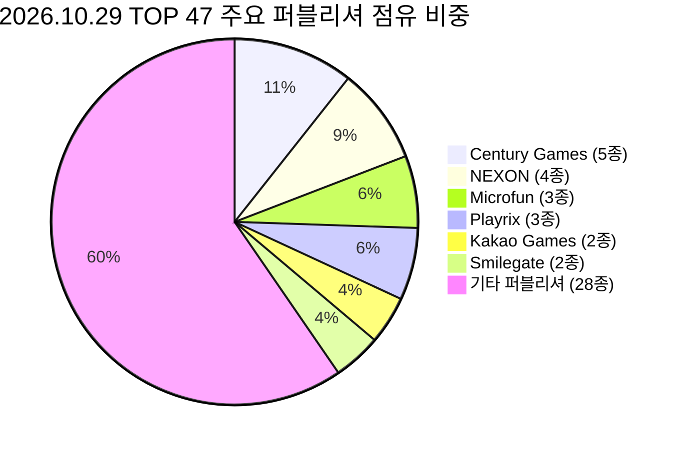

# [심층 분석 보고서] 2026년 10월 말 모바일 게임 시장 지형도와 메타 지각변동

> **문서 정보**
> - **작성일**: 2026-10-29
> - **작성자**: 조준수 (Jo Junsu)
> - **분석 데이터**: 모바일인덱스(MobileIndex) 국내 실시간 매출 순위 (Google Play & Apple App Store)
> - **비교 기준**: 2026-10-01 스냅샷 대비 28일간의 변동 추이
> - **문서 성격**: 100_Projects 과제 산출물 / QA 및 기획 전략 기저 데이터

---

## 📌 목차
1. [핵심 요약 (Executive Summary)](#1-핵심-요약-executive-summary)
2. [10월 29일 차트 지각변동의 4대 핵심 축](#2-10월-29일-차트-지각변동의-4대-핵심-축)
3. [플랫폼별(Google Play vs iOS App Store) 양극화 비교](#3-플랫폼별google-play-vs-ios-app-store-양극화-비교)
4. [퍼블리셔별 전략과 시장 점유 현황](#4-퍼블리셔별-전략과-시장-점유-현황)
5. [장르 메타 변화: 머지(Merge)와 하이브리드 캐주얼의 승리](#5-장르-메타-변화-머지merge와-하이브리드-캐주얼의-승리)
6. [시계열 순위 변동 요약표 (주요 15선)](#6-시계열-순위-변동-요약표-주요-15선)
7. [결론 및 차기 과제 연계 방향](#7-결론-및-차기-과제-연계-방향)

---

## 1. 핵심 요약 (Executive Summary)

2026년 10월 29일자 모바일인덱스 실시간 매출 순위는 **국내 MMORPG의 신작 교체**, **Century Games의 글로벌 라인업 독식**, 그리고 **머지(Merge) 2 장르의 사상 최대 순위 기록**으로 요약됩니다.

```
┌────────────────────────────────────────────────────────────────────────┐
│               🔥 2026.10.29 시장 지형도 3대 핵심 포인트                │
├───────────────────┬────────────────────────────────────────────────────┤
│ 1. 신작 제왕 등극 │ 카카오게임즈 『도깨비의세계』 구글 1위 · iOS 2위 석권  │
│ 2. Century 제국   │ Century Games 계열 TOP 42 내 5종 진입 (WOS iOS 1위)│
│ 3. 머지 장르 대세 │ Microfun 『가십하버』 구글 5위 · iOS 3위 역사적 고점  │
└───────────────────┴────────────────────────────────────────────────────┘
```

10월 초 차트를 지배했던 서브컬처 대작(명조, 트릭컬)의 이벤트 거품이 빠지며, 지속 과금력이 증명된 **하이브리드 캐주얼(SLG+미니게임)**과 **여성 타깃 머지 게임**이 차트 최상위권의 견고한 지분을 장악했습니다.

---

## 2. 10월 29일 차트 지각변동의 4대 핵심 축

### ① 카카오게임즈의 역작, 『도깨비의세계』 1위 돌풍
- **데이터 사실**: 10월 1일 차트에 없던 신규 타이틀로, 출시 직후 **Google Play 매출 1위, Apple App Store 매출 2위**를 동시 달성.
- **분석**: 한국 전통 설화와 도깨비 IP를 현대적으로 재해석한 비주얼과 압도적인 마케팅 물량 공세가 주효했습니다. 기존 『오딘: 발할라 라이징』(구글 16위)의 유저를 잠식하지 않으면서 2040 남녀 유저층을 광범위하게 흡수했습니다.

### ② Century Games의 포트폴리오 장악 (5종 차트인)
- **데이터 사실**: 
  - 『WOS: 화이트아웃 서바이벌』: Google 3위, **iOS 1위**
  - 『킹샷:Kingshot』: Google 4위, iOS 8위
  - 『테이스티 트레블: 합성』: Google 19위, iOS 13위
  - 『Top Force』: Google 39위 (신규)
  - 『로드러쉬』: Google 42위 (신규)
- **분석**: 단일 퍼블리셔가 전략 4X, 캐주얼 슈팅, 머지 퍼즐 등 3개 이상의 이종 장르를 양대 마켓 최상위권에 5개나 꽂아 넣은 초유의 성과입니다. '가짜 광고(Fake Ad)'로 시작해 미니게임과 4X 엔진을 결합하는 '하이브리드 UA 전략'이 글로벌 시장에서 완전한 승리 공식으로 자리 잡았음을 방증합니다.

### ③ 머지 2(Merge-2) 장르의 폭발적 주류화
- **데이터 사실**: Microfun Limited의 『가십하버』가 **Google Play 5위(+6), App Store 3위(+9)**를 기록하며 역대 최고 순위를 경신.
- **분석**: 과거 Match-3(캔디크러쉬, 로얄매치)가 차지하던 캐주얼 퍼즐 파이를 머지 2 메커니즘과 자극적인 드라마 내러티브가 완벽히 대체했습니다. 서브작인 『씨사이드 익스케이프』(구글 23위/iOS 17위)와 신규 『핫레스토랑』(iOS 29위)까지 합세하여 Microfun은 한국 시장에서 월 수백억 대의 머지 생태계를 구축했습니다.

### ④ 서브컬처 버스트 BM의 롤러코스터 주기 확인
- **데이터 사실**: 
  - 『명조: 워더링 웨이브』: 10/01 iOS 1위 → 10/29 **iOS 29위 밖(차트아웃)** (단, 구글은 22위→14위로 버팀)
  - 『트릭컬 리바이브』: 10/01 3주년 구글 6위 → 10/29 **구글 40위 밖**
- **시사점**: 서브컬처 장르는 대규모 버전 업데이트와 캐릭터 픽업 당일 1~3일간 폭발적인 매출을 기록한 후 급속도로 순위가 하향 안정화되는 전형적인 '버스트(Burst)' 곡선을 재확인시켰습니다.

---

## 3. 플랫폼별(Google Play vs iOS App Store) 양극화 비교

| 비교 항목 | Google Play 스토어 (안드로이드) | Apple App Store (iOS) |
|:---|:---|:---|
| **매출 1위** | **도깨비의세계** (Kakao Games) | **WOS: 화이트아웃 서바이벌** (Century Games) |
| **TOP 10 내 장르 비중** | MMORPG (4종: 도깨비, 제우스, SOL, 리니지M)<br>전략/퍼즐 (6종) | 전략/캐주얼 (7종: WOS, 가십하버, 로얄매치 등)<br>MMORPG (2종: 도깨비, 제우스) |
| **야구 게임 특수** | 『컴투스프로야구V26』 **31위** | 『컴투스프로야구V26』 **5위** (26계단 격차) |
| **유저 과금 성향** | 4050 린저씨/고래 유저의 하드코어 PvP 지속 과금 | 2030 직장인/여성 유저의 패스·스킨 및 캐주얼 즉시 과금 |

---

## 4. 퍼블리셔별 전략과 시장 점유 현황



1. **스마일게이트의 장르 다각화**: 런칭작 『이클립스』가 10위에 안착한 가운데, 신작 『카오스 제로 나이트메어』(구글 21위)를 안착시키며 하드코어와 서브컬처 라인업을 완성했습니다.
2. **넥슨의 지식재산권(IP) 수성**: 『메이플 키우기』(구글 13위/iOS 9위), 『FC 모바일』(26위), 『던전앤파이터 모바일』(32위 재진입)로 흔들림 없는 허리 라인을 구성하고 있습니다.

---

## 5. 장르 메타 변화: 머지(Merge)와 하이브리드 캐주얼의 승리

과거 모바일 시장이 **"하드코어 MMORPG vs Match-3 퍼즐"**의 대립이었다면, 2026년 하반기 현재는 다음과 같이 재편되었습니다:
1. **머지 2 (Merge-2)**: 체력(에너지) 과금 + 보드 확장 + 막장 드라마 서사의 3중 루프를 통한 여성 및 3040 유저 락인.
2. **하이브리드 SLG**: 저비용 미니게임(슈팅, 핀뽑기)으로 유입시킨 후 심도 깊은 연맹전(4X)으로 과금을 유도하는 이중 구조.
3. **스낵형 방치/디펜스**: 『운빨존많겜』(11위), 『협타디』(17위), 『메이플 키우기』(13위)로 대표되는 짧은 호흡과 RNG(무작위성) 기반의 도파민 제공.

---

## 6. 시계열 순위 변동 요약표 (주요 15선)

| 게임명 | 10/01 구글 | 10/29 구글 | 10/01 iOS | 10/29 iOS | 순위 변동 총평 |
|:---|:---:|:---:|:---:|:---:|:---|
| **도깨비의세계** | - | **1위** | - | **2위** | 압도적인 신작 효과로 양대 마켓 최상단 진입 |
| **제우스: 오만의 신** | 1위 | **2위** | 4위 | **4위** | 1위 자리를 양보했으나 여전히 MMORPG 절대 강자 |
| **WOS: 화이트아웃** | 4위 | **3위** | 8위 | **1위** | iOS 1위 탈환으로 글로벌 SLG 저력 입증 |
| **가십하버: 합성** | 11위 | **5위** | 12위 | **3위** | 머지 장르 사상 첫 양대마켓 TOP 5 동시 달성 |
| **로얄 매치** | 12위 | **7위** | 18위 | **7위** | 퍼즐 장르 1위 탈환 (꿈의정원 대비 우위) |
| **운빨존많겜** | 10위 | **11위** | 7위 | **6위** | 출시 수개월 후에도 흔들림 없는 롱런 파워 |
| **명조:워더링 웨이브** | 22위 | **14위** | 1위 | **차트아웃** | 극단적인 버스트 BM 주기 노출 |
| **탑 로드** | 29위 | **15위** | 27위 | **14위** | 양대 마켓 13~14계단 동시 급등한 다크호스 |
| **협타디** | 30위 | **17위** | 26위 | **15위** | 캐주얼 협동 디펜스 장르의 조용한 역주행 |
| **카오스 제로 나이트메어** | - | **21위** | - | **41위** | 스마일게이트의 서브컬처 신작 순위권 진입 |
| **아쿠아랜드** | 32위 | **29위** | 42위 | **18위** | iOS에서 24계단 폭등한 해양 서바이벌 게임 |
| **컴투스프로야구V26** | 25위 | **31위** | 3위 | **5위** | 포스트시즌 종료 국면에 따른 완만한 하향 |
| **트릭컬 리바이브** | 6위 | **40위 밖** | 40위권 | **40위 밖** | 3주년 프로모션 종료 후 정상화 |

---

## 7. 결론 및 차기 과제 연계 방향

본 10월 29일 모바일인덱스 순위 데이터는 향후 **QA 분석 및 시스템 기획 과제**를 수행할 때 다음과 같은 명확한 방향타를 제시합니다:

1. **차기 분석 최우선 대상**:
   - 현재 양대 마켓 최정상을 장악한 **『도깨비의세계』 (카카오게임즈)**에 대한 온보딩 UX 및 밸런스 QA 분석.
   - 글로벌 매출 3위권으로 치고 올라온 **『가십하버』 (Microfun)**의 머지 2 코어 루프와 결제 유도선 역기획.
2. **실무적 교훈**:
   - 일시적인 픽업 순위(명조 1위 등)에 현혹되지 않고, 지속적으로 차트 상위에 남는 코어 시스템과 라이브 운영 역량을 분석 과제의 뼈대로 삼아야 함.
   - [차기_QA_및_기획_과제_게임_추천_로드맵.md](차기_QA_및_기획_과제_게임_추천_로드맵.md)를 통해 세부 실행 과제에 착수합니다.
