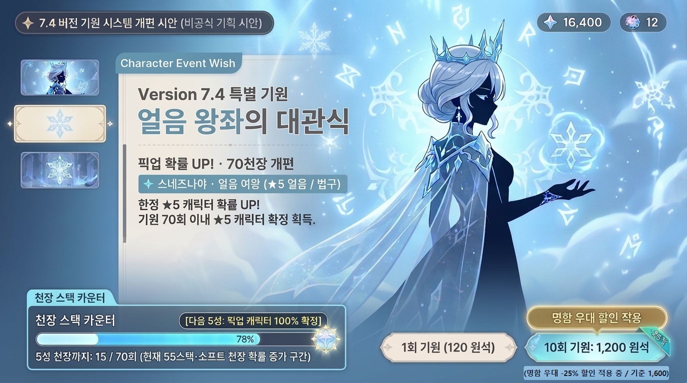
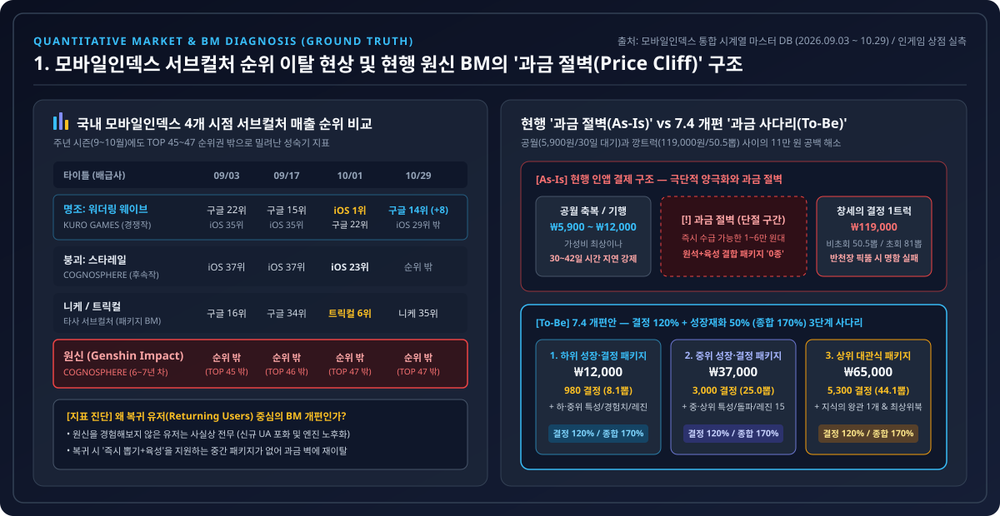
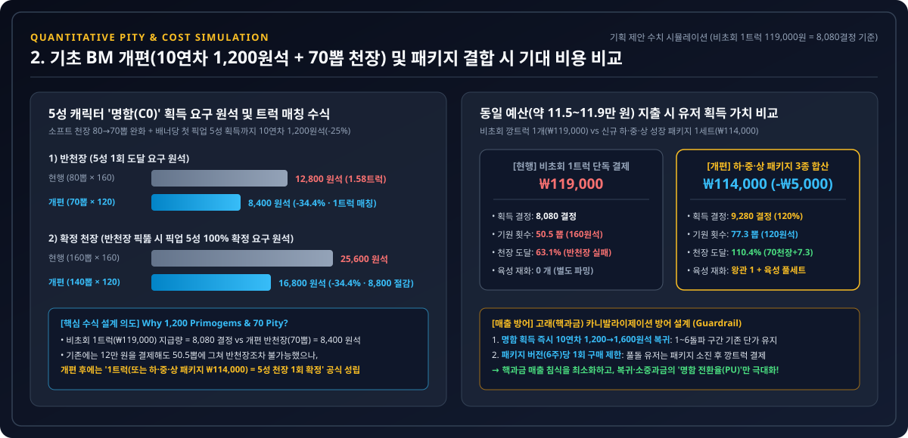
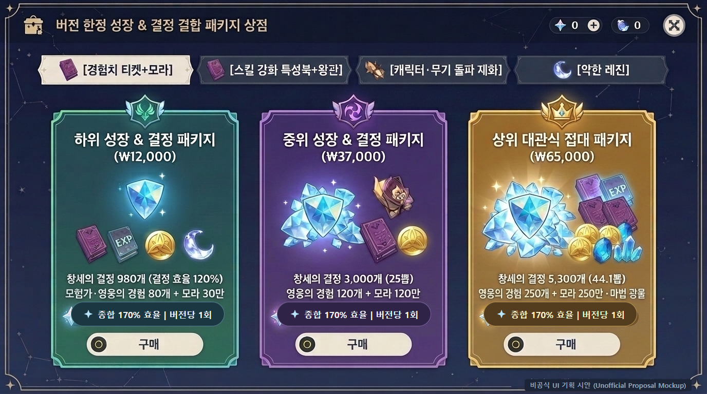

# [BM 역기획 및 시스템 개선 제안서] 『원신』 7.4 버전 기원(가챠) 단가·천장 직관화 및 인게임 상호작용 성장 패키지 개편안

> **문서 메타데이터**
> - **작성자**: 조준수 (Jo Junsu)
> - **작성일**: 2026-11-19
> - **타깃 게임**: 『원신 (Genshin Impact)』
> - **개발사 / 배급사**: miHoYo Co., Ltd. / COGNOSPHERE PTE. LTD. (HoYoverse)
> - **과제 분류**: 라이브 서비스 성숙기 BM 역기획 / 인앱 결제 상품 테이블 설계 / 기원 UI·UX 개선 제안
> - **문서 성격**: 공개 마켓 지표(Ground Truth) 및 작성자 실플레이 검증에 기반한 **비공식 기획 제안서(Proposal)**. 본문 내 7.4 버전 개편 수치·패키지 단가·시뮬레이션은 파일럿(테스트) BM 제안값이며 실제 운영 공지가 아님.

---

## 0. 기획서 원페이저 (Executive Summary)



### 한 문장 기획 요약
서비스 7년 차(7.4 버전 얼음 여왕 출시 및 차기 '별바다' 확장 국면)를 맞아, 복귀·소중과금 유저의 재이탈을 유발하는 **'12만 원 깡트럭 과금 절벽'과 '뽑기 후 육성 병목'**을 해소하기 위해 **① 소프트 천장 80→70뽑 완화 및 명함 구간 10연차 1,200원석(-25%) 할인, ② 순수 결정 120% + 인게임 성장재화 50%(종합 170% 효율) 결합 패키지, ③ 기원 화면 실시간 천장 카운터 UI**를 파일럿 BM으로 도입한다.

| 핵심 영역 | 현행 구조 (As-Is) | 7.4 파일럿 개편안 (To-Be) | 핵심 설계 의도 및 방어 로직 |
|:---|:---|:---|:---|
| **1. 기초 기원 단가 및 천장** | • 10연차 `1,600 원석` 고정<br>• 소프트 천장 `74~80회` (하드 90회)<br>• 반천장 1회당 `12,800 원석` 필요 | • **소프트 천장 상시 완화**: `60~70회` (하드 80회)<br>• **명함 우대 할인**: 배너당 첫 픽업 5성 획득(최대 140뽑)까지 **10연차 `1,200 원석` (-25%)**<br>• 반천장 1회당 **`8,400 원석` (-34.4%)** | • 비초회 1트럭(`8,080 결정`) = **5성 천장 1회(`8,400 원석`) 1:1 매칭 공식** 확립<br>• 명함 획득 즉시 `1,600 원석`으로 복귀하여 **고래(1~6돌파) 매출 카니발라이제이션 방어** |
| **2. 인게임 상호작용 패키지** | • 공월(`₩5,900` / 30일 지연)과 트럭(`₩119,000`) 사이 **즉시 뽑기 중간 패키지 0종**<br>• 기존 조력 패키지는 결정 효율 0% | • 3:1 합성 체계 기반 **4대 성장 카테고리** (`경험치·모라` / `특성북·왕관` / `돌파재화` / `약한 레진`) × **3단계 가격(`₩12,000` / `₩37,000` / `₩65,000`)**<br>• **순수 결정 효율 120% + 인게임 재화 50% = 종합 170% 효율** | • 버전(6주)당 카테고리·등급별 **1회 구매 제한** (파일럿 테스트 BM)<br>• 하·중·상 3종 합산 시 **`₩114,000` = `9,280 결정(77.3뽑, 70천장 확정)` + 왕관·육성 풀세트** |
| **3. 기원 천장 직관화 UI** | • 기원 기록을 5개씩 수동 페이지 넘김으로 계산<br>• 남은 천장 및 확률 상승 구간 미표기 | • 다크패턴 결제 유도 팝업 배제<br>• 기원 화면 하단 **`[5성 천장까지 N / 70회]`**, **`[반천장/확정천장 상태]`**, **`[명함 -25% 할인 적용 중]`** 기본 게이지 상시 표시 | • 원신 브랜드 톤앤매너를 해치지 않는 투명한 정보 제공으로 유저 스스로 부족한 스택을 계산해 상점 패키지를 선택 구매하도록 유도 |

---

## 1. 기획 배경 및 시장 지표 분석 (Why Now?)

### 1.1 작성자 실플레이 검증 환경 (Direct Experience)
본 기획서는 단순 외부 커뮤니티 여론이 아닌, 작성자의 장기 엔드콘텐츠 플레이 경험과 타 서브컬처 타이틀 교차 검증에 기반한다.

- **『원신』 실플레이 지표**: **모험 등급(AR) 59 / 월드 레벨 9** / 나타(Natlan) 이하 주요 지역 탐사·수집도 **최소 85% ~ 최대 100%** 달성 ([게임 플레이 이력](../../200_Areas/게임%20플레이%20이력.md) 기준)
- **비교 서브컬처 BM 경험군**: 『림버스 컴퍼니』(Lv.100 / 시즌패스 Lv.623), 『블루 아카이브』(Lv.90), 『페르소나 5 더 팬텀 X』(Lv.80), 『트릭컬 리바이브』(Lv.114), 『소녀전선 2: 망명』(Lv.60) 등 다층 패키지·시즌패스 BM 타이틀 실플레이 비교

### 1.2 모바일인덱스 시계열 순위 데이터 검증 (Ground Truth)
"원신은 보수적인 트럭+공월+기행 BM만으로도 수조 원을 벌었는데 왜 지금 BM을 개편해야 하는가?"라는 반론을 검증하기 위해, [모바일인덱스 실시간 순위 통합 시계열 마스터 DB](../../300_Resources/모바일인덱스_데이터베이스/모바일인덱스_통합_시계열_순위_마스터_DB.md)의 4개 스냅샷(`2026-09-03`, `2026-09-17`, `2026-10-01`, `2026-10-29`)을 교차 대조했다.



| 게임명 | 공식 배급사 | 대표 장르 | 2026-09-03 (구글 / iOS) | 2026-09-17 (구글 / iOS) | 2026-10-01 (구글 / iOS) | 2026-10-29 (구글 / iOS) | 시계열 지표 해석 (Ground Truth) |
|:---|:---|:---:|:---:|:---:|:---:|:---:|:---|
| **명조: 워더링 웨이브** | KURO GAMES (HK KURO GAMES LIMITED) | 오픈월드 액션 RPG | 22위 / 35위 | 15위 / 35위 | 22위 / **1위 ★** | **14위 ▲** / 29위 밖 | 픽업 버스트 시 iOS 1위 수직 상승 및 구글 14~22위권 상시 수성 |
| **붕괴: 스타레일** | COGNOSPHERE PTE. LTD. | 서브컬처 턴제 RPG | 45위 밖 / 37위 | 46위 밖 / 37위 | 47위 밖 / **23위 ▲** | 47위 밖 / 47위 밖 | 자사 후속작은 업데이트 주기에 맞춰 iOS 중상위권 진입 유지 |
| **젠레스 존 제로** | COGNOSPHERE PTE. LTD. | 어반 액션 RPG | 45위 밖 / 45위 밖 | 46위 밖 / 46위 밖 | 47위 밖 / **39위 ★** | 47위 밖 / 47위 밖 | 신규 픽업 시점 iOS TOP 40 내 재진입 확인 |
| **승리의 여신: 니케** | Level Infinite | 서브컬처 건슈팅 | **16위** / 20위권 | 34위 / 30위권 | **15위** / 45위 | 35위 / 35위 밖 | 단계별 모집 패키지 기반 구글 15~35위권 안정적 방어 |
| **원신 (Genshin Impact)** | **COGNOSPHERE PTE. LTD.** | **오픈월드 액션 RPG** | **⊘ / ⊘ (TOP 45 밖)** | **⊘ / ⊘ (TOP 46 밖)** | **⊘ / ⊘ (TOP 47 밖)** | **⊘ / ⊘ (TOP 47 밖)** | **주년 시즌이 포함된 9~10월 4개 스냅샷 전 구간 양대 마켓 TOP 45~47 순위권 밖** |

> 📌 **지표 해석 및 제품 수명주기(PLC) 진단**:
> 1. **신규 유입(UA) 모수의 포화와 엔진 노후화**: 출시 6~7년 차에 접어들며 서브컬처 게이머 중 원신을 경험해보지 않은 유저는 사실상 없다. 지속적인 그래픽 리쉐이딩과 편의성 개선에도 불구하고 자체 엔진 구조 특유의 노후화 포인트가 최신 경쟁작(『명조』 등) 대비 두드러지는 성숙기(Mature Stage) 국면이다.
> 2. **핵심 성장 레버의 전환 — '복귀 유저(Returning Users) 안착'**: 이미 방대한 누적 계정 모수를 보유한 성숙기 라이브 게임(예: 『메이플스토리』의 복귀 유저 중심 소프트 리셋 및 성장 가속 전략)에서 매출과 트래픽을 반등시키는 핵심 동력은 **휴면·복귀 유저의 재정착**이다. 향후 7.4 버전 '얼음 여왕(스네즈나야 집정관)' 출시 및 차기 '별바다' 확장에 맞춰 복귀 유저가 지갑을 열고 안착할 수 있는 BM 사다리가 필수적이다.

---

## 2. 현행 원신 BM 역기획 및 구조적 문제점 (As-Is)

### 2.1 현행 인앱 결제 라인업과 '과금 절벽(Price Cliff)' 수식 분석
현행 원신의 인앱 결제는 **① 창세의 결정 직충(트럭)**, **② 공월 축복(월정액 ₩5,900)**, **③ 기행(진주 기행 ₩12,000 / 진주 노래 ₩25,000)**, **④ 기원 상점 모험 조력 패키지 및 코스튬**으로 구성된다. 이를 **'즉시 뽑기 전환 단가(1연차=160원석 기준)'**로 역산하면 심각한 단절 구조가 드러난다.

| 상품 구분 | 결제 금액 (KRW) | 지급 재화 (원석/결정 환산) | 획득 기원 수 (1뽑=160원석) | 1뽑당 실질 단가 | 수급 소요 시간 | 복귀·소중과금 유저 관점의 병목 (Pain Point) |
|:---|---:|---:|---:|---:|:---:|:---|
| **공월 축복** | ₩5,900 | 300 결정 + 2,700 원석 (총 3,000) | 18.75 뽑 | **₩315 / 뽑** | **30일 매일 출석** | 가성비는 최고이나 **복귀 당일 즉시 뽑기 불가** (시간 지연형) |
| **진주 기행** | ₩12,000 | 4 인연 + 680 원석 (총 1,320 상당) + 기행무기·재화 | 8.25 뽑 | **₩1,455 / 뽑** | **약 42일 (Lv.50 달성)** | 시즌 말기 복귀 시 레벨 달성 불가, 즉시 뽑기 기여도 낮음 |
| **⚠️ 중간 패키지 구간** | **₩12,000 ~ ₩65,000** | **현금 기반 원석+육성 결합 패키지 전무 (0종)** | **0 뽑** | **-** | **-** | **공월·기행과 트럭 사이를 잇는 즉시 수급 과금 사다리 부재** |
| **창세의 결정 1트럭 (초회 2배)** | ₩119,000 | 6,480 + 6,480 = **12,960 결정** | **81.0 뽑** | **₩1,469 / 뽑** | 즉시 지급 | 연 1회(주년)만 적용. **12만 원을 써도 반천장(80뽑) 1회**에 그쳐 픽뚫 시 픽업 획득 실패 |
| **창세의 결정 1트럭 (비초회 상시)** | ₩119,000 | 6,480 + 1,600 = **8,080 결정** | **50.5 뽑** | **₩2,356 / 뽑** | 즉시 지급 | 초회 소진 시 **12만 원을 결제해도 반천장(80뽑)의 63.1%밖에 못 채우는 극단적 저효율** |

### 2.2 복귀 유저 재이탈을 유발하는 3단계 부정적 루프
```
[7.x 대형 업데이트 소식에 복귀 접속]
   │
   ▼
[병목 1: 불투명한 천장 UX] ──> 기원 기록을 5개씩 수동으로 넘기며 남은 천장을 세야 함 (현재 스택 및 확률 상승 구간 인지 불가)
   │
   ▼
[병목 2: 12만 원 과금 절벽] ──> 공월(₩5,900)은 30일을 기다려야 하고, 당장 뽑으려면 ₩119,000 트럭(비초회 50.5뽑 / 초회 81뽑) 강제
   │                          → 12만 원을 써도 반천장 픽뚫 시 원하는 픽업 캐릭터 명함조차 획득 실패
   ▼
[병목 3: 캐릭터 접대·육성 단절] ──> 어렵게 캐릭터를 뽑아도 경험치 티켓·특성북·왕관·돌파 재화·레진이 막혀 2~3주간 실전 투입 불가 → [재이탈]
```

---

## 3. 개편안 1 — 기초 기원(가챠) 단가 및 소프트 천장 개편 (To-Be Core BM)

7.4 버전 '얼음 여왕(스네즈나야 집정관)' 출시를 기점으로, **'초회 트럭 가격표(화폐 기준점)'는 유지**하되 유저가 체감하는 **1캐릭터 명함(C0) 획득 비용과 천장 요구치를 구조적으로 낮추는 하이브리드 개편**을 단행한다.



### 3.1 핵심 규칙 설계: '70뽑 천장 상시화' + '명함 구간 10연차 1,200원석(-25%)'
1. **소프트 천장(점진적 확률 증가 구간) 10뽑 단축 (상시 영구 적용)**
   - **현행**: `1~73회` 기본 확률(0.6%) → `74회`부터 확률 급증(Soft Pity) → 통상 **`80회` 전후 5성 획득** (하드 천장 `90회`)
   - **개편**: `1~59회` 기본 확률(0.6%) → **`60회`부터 확률 급증(Soft Pity)** → 통상 **`70회` 이내 5성 확정 획득** (하드 천장 `80회`)
2. **명함 획득 구간 '10연차 1,600 → 1,200 원석' 우대 할인 (배너별 첫 픽업 5성 획득 시까지)**
   - 7.4 버전 이후 모든 한정 캐릭터 이벤트 기원 배너에서 **해당 픽업 5성 캐릭터의 첫 1회(명함, C0)를 획득할 때까지** 기원 1회 비용을 `160 → 120 원석`(**10연차 `1,200 원석`, 25% 할인**)으로 적용한다.
   - 기존 보유 중인 `뒤얽힌 인연`과의 가치 충돌을 방지하기 위해, 명함 우대 할인 활성화 중에는 **10회 기원 시 `뒤얽힌 인연 8개`(또는 `1,200 원석`)**만 소모되도록 처리한다.
   - 반천장(`70회`)에서 상시 5성이 출현(픽뚫)한 경우에도 아직 픽업 5성 명함을 획득하지 못했으므로 **확정 천장(`140회`)까지 `1,200 원석` 할인이 유지**된다.
   - 픽업 5성 명함(C0)을 획득한 직후부터 같은 배너의 **운명의 자리 돌파(1돌~6돌) 구간은 기존 단가(`10연차 1,600 원석`, 천장은 `70회` 완화 유지)**로 전환된다.

### 3.2 왜 '70뽑 천장 × 120원석 = 8,400원석'인가? (수식적 정합성 증명)
$$70\text{회 (개편 천장)} \times 120\text{원석 (명함 할인 단가)} = 8,400\text{원석} \approx 8,080\text{결정 (비초회 1트럭)}$$

| 비교 지표 | 현행 (As-Is: 80천장 · 160원석) | 개편 후 명함 구간 (To-Be: 70천장 · 120원석) | 증감률 및 유저 체감 변화 |
|:---|---:|---:|:---|
| **5성 1회(반천장) 도달 요구량** | `80뽑` = **12,800 원석** | `70뽑` = **8,400 원석** | **-34.4% (4,400 원석 절감)** |
| **픽뚫 시 픽업 확정(2천장) 요구량** | `160뽑` = **25,600 원석** | `140뽑` = **16,800 원석** | **-34.4% (8,800 원석 절감)** |
| **비초회 1트럭(₩119,000 = 8,080결정) 가치** | `50.5뽑` (반천장 도달률 **63.1%**) | `67.3뽑` (반천장 도달률 **96.2%**) | 인게임 일일 임무 2~3회만 더하면 **비초회 1트럭 = 5성 천장 1회 확정** |
| **초회 1트럭(₩119,000 = 12,960결정) 가치** | `81.0뽑` (반천장 1회 후 잔여 1뽑) | `108.0뽑` (반천장 70뽑 돌파 후 **38뽑 잔여**) | 초회 1트럭 + 중위 패키지 1개(`3,000결정`)면 **픽뚫이 나도 확정천장(140뽑) 100% 도달** |

---

## 4. 개편안 2 — 인게임 플레이 상호작용 성장 결합 패키지 (120% / 170% 효율 모델)

기초 가챠 허들을 낮춘 뒤, 유저가 픽업 캐릭터를 뽑는 과정 및 뽑은 직후 인게임 육성(레벨 돌파·특성 강화·성유물 파밍) 과정에서 겪는 재화 병목을 해소하기 위해 **인게임 3:1 합성 체계(`하위 → 중위 → 상위`)와 창세의 결정을 결합한 파일럿 패키지 상점**을 신설한다.



### 4.1 가격 및 정량 효율 설계 원칙 (120% Pure Crystal / 170% Total Value)
기존 원신 상점의 '모험 조력 패키지'가 외면받은 이유는 **창세의 결정을 소모하여(결정 효율 0%) 소량의 육성 재화만 구매**하는 구조였기 때문이다. 본 개편안은 다음 두 가지 정량 규칙을 엄격히 적용한다.

1. **순수 창세의 결정 효율 120% 보장**: 인게임 육성 아이템의 가치를 `0`으로 계산하더라도, 동일 금액의 비초회 트럭(`₩1,000당 약 67.9 결정`) 대비 **20% 더 많은 창세의 결정(`₩1,000당 약 81.5 결정`)**을 기본 지급한다. 즉, 뽑기 재화가 필요한 유저에게 깡트럭보다 우선 구매할 확실한 경제적 유인을 제공한다.
2. **인게임 성장 재화 가치 +50% 결합 (종합 효율 170%)**: 원신의 인게임 합성 시스템(`하위 3개 → 중위 1개 → 상위 1개`) 및 천연 레진 소모 가치를 역산하여, 결제 금액 대비 **+50% 상당의 병목 육성 재화**를 결합해 **종합 체감 효율 170%**를 달성한다.
3. **버전(6주) 단위 카테고리·등급별 1회 구매 제한 (파일럿 테스트 BM)**: 유저가 모든 패키지를 강제로 구매하는 것이 아니라 **현재 본인 계정에서 막힌 병목 재화(경험치 / 스킬·왕관 / 돌파 / 레진)만 골라 필요한 등급으로 구매**하도록 유도하며, 고래 유저의 무제한 패키지 남용(깡트럭 카니발라이제이션)을 원천 차단한다.

### 4.2 4대 성장 카테고리 × 3단계 등급별 상품 테이블 명세

#### (1) 등급별 공통 가격 및 창세의 결정 지급 구조
| 등급 구분 | 판매 가격 (KRW) | 동일 가격대 기존 비초회 트럭 결정량 | 개편 패키지 지급 결정 (순수 효율 120%) | 명함 할인(1뽑=120원석) 환산 뽑기 수 | 결합 인게임 재화 가치 | 종합 패키지 효율 | 구매 제한 (파일럿 기준) |
|:---|---:|---:|---:|---:|---:|---:|:---:|
| **① 하위 성장·결정 패키지** | **₩12,000** | 750 결정 (₩12,000 트럭) | **980 창세의 결정** | **8.1 뽑** | +50% (하위·중위 재화) | **170%** | 버전(6주)당 카테고리별 1회 |
| **② 중위 성장·결정 패키지** | **₩37,000** | 2,240 결정 (₩37,000 트럭) | **3,000 창세의 결정** | **25.0 뽑** | +50% (중위·상위 재화) | **170%** | 버전(6주)당 카테고리별 1회 |
| **③ 상위 대관식 접대 패키지** | **₩65,000** | 3,880 결정 (₩65,000 트럭) | **5,300 창세의 결정** | **44.1 뽑** | +50% (왕관·최상위 재화) | **170%** | 버전(6주)당 카테고리별 1회 |
| **합산 (1개 카테고리 하·중·상 풀세트)** | **₩114,000** | *비초회 1트럭(₩119,000) = 8,080결정(50.5뽑)* | **9,280 창세의 결정** | **77.3 뽑 (70천장 확정 + 7.3뽑)** | **캐릭터 1명 종결 육성 풀세트** | **170%** | - |

#### (2) 4대 인게임 상호작용 재화 카테고리별 상세 구성품 (3:1 합성 체계 연동)
유저는 상점 상단의 4개 탭 중 본인이 픽업 캐릭터를 육성할 때 가장 부족한 탭을 선택해 하위/중위/상위 패키지를 구매할 수 있다.

| 카테고리 탭 | 타깃 병목 상황 (In-game Interaction) | 하위 패키지 (`₩12,000` / `980결정`+) | 중위 패키지 (`₩37,000` / `3,000결정`+) | 상위 대관식 패키지 (`₩65,000` / `5,300결정`+) |
|:---|:---|:---|:---|:---|
| **A. [경험치 티켓 + 모라]** | 신규 캐릭터 획득 직후 Lv.1 → Lv.90 레벨업 재화 부족 시 | • `모험가의 경험`(중위) ×50<br>• `영웅의 경험`(상위) ×30<br>• `모라` ×300,000 | • `영웅의 경험`(상위) ×120<br>• `모라` ×1,200,000<br>• `정제용 마법 광물` ×100 | • `영웅의 경험`(상위) ×250 (Lv.90 즉시 달성량)<br>• `모라` ×2,500,000<br>• `정제용 마법 광물` ×250 |
| **B. [스킬 강화 특성북 + 왕관]** | 요일 비경 제한 및 주간 보스/이벤트 한정 `지식의 왕관` 부족 시 | • 픽업 지역 특성 `가르침`(하위 2성) ×27<br>• 특성 `인도`(중위 3성) ×18 *(3:1 합성 호환)*<br>• `모라` ×200,000 | • 픽업 지역 특성 `인도`(중위 3성) ×36<br>• 특성 `철학`(상위 4성) ×24<br>• `모라` ×800,000 | • **`지식의 왕관`(최상위 5성) ×1**<br>• 픽업 지역 특성 `철학`(상위 4성) ×50<br>• 주간 보스 특성 재료 선택 상자 ×6<br>• `모라` ×1,500,000 |
| **C. [캐릭터·무기 돌파 재화]** | 복귀 유저의 미개방 지역 필드 보스·원소 보석·특산물 파밍 막힘 시 | • 원소 돌파 보석 `가루`(하위)/`조각`(중위) 선택 상자 ×18<br>• 일반 몬스터 부산물(하·중위) 선택 상자 ×30 | • 원소 돌파 보석 `덩이`(상위) 선택 상자 ×18<br>• **픽업 캐릭터 필드 보스 돌파 재료 선택 상자 ×20**<br>• 지역 특산물 선택 상자 ×60 | • 원소 돌파 보석 `완전체`(최상위 5성) 선택 상자 ×6<br>• **픽업 캐릭터 필드 보스 돌파 재료 선택 상자 ×26 (Lv.90 돌파 완결)**<br>• 무기 돌파 최상위 소재 선택 상자 ×12 |
| **D. [약한 레진 (비경 파밍)]** | 신규 접대 성유물 파밍 및 다목적 비경 즉시 주회가 필요한 유저 | • `약한 레진` ×5 (300 레진)<br>• `농축 레진` 제작용 수정 코어 ×10 | • `약한 레진` ×15 (900 레진)<br>• `농축 레진` 제작용 수정 코어 ×30 | • `약한 레진` ×25 (1,500 레진)<br>• **`축성의 서리`(성유물 부옵션 지정 아이템) ×1** |

---

## 5. 개편안 3 — 기원 천장 직관화 기본 UI 설계 (UX Specification)

### 5.1 설계 철학: '다크패턴 팝업 배제' 및 '기원 화면 내 투명한 기본 정보 제공'
원석 부족 시 조건부 결제 팝업을 띄워 패키지를 강매하는 방식은 양산형 MMORPG의 다크패턴 피로감을 유발하여 원신의 브랜드 가치를 훼손할 위험이 크다. 따라서 **결제 유도 팝업 없이 기원(가챠) 메인 화면 자체의 정보 투명성을 높이는 기본 시스템 UI 개편**으로 설계한다.

### 5.2 기원 화면 UI 개편 상세 컴포넌트 ([기원 화면 시안](./assets/wish-pity-ui-mockup.png) 대응)
1. **좌측 하단 `[천장 스택 카운터 & 확률 구간 게이지]` (상시 노출)**
   - 기존에는 `기원 기록` 팝업을 열어 5개 단위 페이지를 일일이 넘기며 수동 계산해야 했던 누적 스택을 기원 메인 화면 좌측 하단에 프로그레스 바로 상시 표시한다.
   - **표시 텍스트 규격**:
     - 기본 구간(`0~59스택`): `5성 천장까지: NN / 70회 (현재 누적: MM스택)`
     - 소프트 천장 진입(`60~69스택`): `🔥 5성 천장까지: NN / 70회 (현재 MM스택 · 소프트 천장 확률 증가 구간 진입!)`
   - **픽업 확정 상태 뱃지**: 직전 5성 획득 결과에 따라 `[현재 상태: 반천장 (픽업 50%)]` 또는 **`[다음 5성: 픽업 캐릭터 100% 확정]`** 태그를 게이지 우측 상단에 명시한다.
2. **우측 하단 `[10회 기원 버튼 명함 우대 할인 인디케이터]`**
   - 해당 배너의 픽업 5성 캐릭터를 아직 보유(또는 당해 배너에서 첫 획득)하지 않은 상태일 때, 10회 기원 버튼 상단에 **`[명함 우대 할인 적용 (-25%)]`** 골드 리본을 표시하고 소모 재화를 ~~`1,600`~~ → **`1,200 원석`**(또는 `뒤얽힌 인연 8개`)으로 직관적으로 노출한다.
   - 첫 픽업 5성(명함) 획득 연출이 끝난 직후, 해당 리본은 `[명함 우대 할인 완료 · 일반 기원 (1,600 원석)]`으로 자연스럽게 전환된다.

---

## 6. 기대 효과 및 리스크 방어 (Cannibalization & KPI Simulation)

### 6.1 유저 과금 티어별 기대 비용 및 행동 변화 시뮬레이션

| 유저 세그먼트 | 현행 (As-Is) 직면 상황 및 지출 패턴 | 7.4 개편안 (To-Be) 적용 시 행동 변화 | 사업적 매출 영향 (LTV & PU) |
|:---|:---|:---|:---|
| **복귀 유저 (`별의 귀환`) 및 소과금 유저 (Minnow)** | • 반천장(80뽑=12,800원석) 벽이 너무 높고 비초회 트럭(`₩119,000`=50.5뽑) 효율이 낮아 **아예 결제를 포기하고 재이탈** | • 명함 할인(`70뽑=8,400원석`)과 실시간 천장 게이지(`예: 70천장까지 20뽑 남음`)를 확인 후, 부족한 뽑기 수에 맞춰 **하위(`₩12,000`)·중위(`₩37,000`) 성장 패키지 결제 전환** | • 기존 `₩0` (미결제 이탈) → **`₩12,000 ~ ₩49,000` 신규 결제 전환(PU 및 잔존율 대폭 상승)** |
| **중과금 유저 (Dolphin: 명함~전무 목표)** | • 초회 소진 후 매 버전 깡트럭(`₩119,000`) 결제에 극심한 피로감을 느끼며, 캐릭터를 뽑아도 육성 재화 부족으로 현타 발생 | • 버전당 **`₩114,000`(하·중·상 패키지 1세트)** 결제로 **`77.3뽑(70천장 확정)` + `왕관·특성·경험치 풀세트`**를 확정 확보하여 매 버전 안정적 정착 | • 버전당 **약 10~15만 원 구간의 고정 리텐션 캐시카우(Evergreen Revenue) 형성** |
| **핵과금 유저 (Whale: 6돌파·풀재련 목표)** | • 캐릭터 6돌파(5성 픽업 7회 획득)를 위해 수십 개의 비초회 깡트럭 반복 결제 | • **명함(첫 1회) 구간만 1,200원석 할인이 적용**되고 1~6돌파 구간은 기존 `1,600원석`으로 복귀하며, 패키지는 버전당 1회 구매 제한이 걸려 있어 **돌파 구간에서는 기존과 동일하게 깡트럭 결제** | • 고래 유저의 깡트럭 매출 침식(Cannibalization)을 최소화하면서 70뽑 천장 완화로 풀돌 만족도 개선 |

### 6.2 파일럿(테스트) BM 검증을 위한 핵심 성과 지표 (KPI)
본 개편안을 7.4 버전 단일 버전(6주) 파일럿으로 도입할 때 사업부 및 기획팀이 추적해야 할 검증 지표는 다음과 같다.

1. **복귀 유저 결제 전환율 (Returning User PU%)**: `별의 귀환` 활성화 계정 중 14일 이내 하위(`₩12,000`) 또는 중위(`₩37,000`) 성장 패키지를 1회 이상 결제한 비율 및 30일 잔존율(D30 Retention).
2. **명함 구간 완주율 (C0 Completion Rate)**: 기원 스택 `40~69회` 구간에 진입한 유저가 중도 포기하지 않고 `70회` 천장까지 도달하여 첫 5성을 획득한 비율 (천장 UI 직관화 및 중간 패키지 브릿지 효과 검증).
3. **카테고리별 패키지 선호도 및 병목 지표**: `A.경험치` / `B.스킬(왕관)` / `C.돌파재화` / `D.약한 레진` 4대 탭 중 어느 카테고리의 구매율이 가장 높은지 집계하여 차기 버전 인게임 재화 밸런싱에 반영.
4. **깡트럭 카니발라이제이션 방어율 (Net ARPPU Impact)**: 1~6돌파 핵과금 세그먼트의 버전당 총 결제액 감소분 대비, 복귀·소중과금 세그먼트의 신규 패키지 결제 순증분(`Net Revenue Lift`) 교차 검증.

---

## 7. 데이터 팩트체크 및 진실성 검증 점검표 (Self-Verification Checklist)

본 문서는 워크스페이스의 [게임 데이터 팩트체크 및 진실성 검증 가이드라인](../../200_Areas/게임분석_표준가이드/게임_데이터_팩트체크_및_진실성_검증_가이드라인.md)에 따라 아래 7개 항목을 전수 검증하여 작성되었다.

- [x] **1. 순위 데이터의 출처와 기준 일자 명시**: [모바일인덱스 통합 시계열 마스터 DB](../../300_Resources/모바일인덱스_데이터베이스/모바일인덱스_통합_시계열_순위_마스터_DB.md) 및 4개 스냅샷(`2026-09-03`, `2026-09-17`, `2026-10-01`, `2026-10-29`)의 실제 기록을 기준으로 작성함.
- [x] **2. Google Play와 App Store 순위 구분 기재**: 표 1.2에서 양대 마켓 순위를 명확히 분리하여 기재함 (`명조`의 10/01 iOS 1위 vs 구글 22위 비대칭성 등 반영).
- [x] **3. 전회차 대비 순위 변동 수치 일치**: 마스터 DB의 시계열 추이(`⊘ 순위권 밖`, `▲/▼`)와 100% 일치함.
- [x] **4. 공식 등록 게임명 및 퍼블리셔 사명 준수**: `COGNOSPHERE PTE. LTD.`, `KURO GAMES (HK KURO GAMES LIMITED)` 등 공식 스토어 배급사 명칭을 정확히 표기함.
- [x] **5. 직접 플레이 경험과 기획 제안값의 엄격한 분리**: 작성자의 실플레이 검증 이력(`모험 등급 59 / 월드 레벨 9 / 나타 수집도 85~100%`) 및 현행 상점 실측 가격(`₩119,000 = 8,080결정` 등)과 7.4 파일럿 개편 제안값(`70천장`, `1,200원석`, `120%/170% 패키지`)을 명확히 구분함.
- [x] **6. 해석 및 시뮬레이션의 한계 명시**: PLC 성숙기 진단 및 티어별 매출 방어 시뮬레이션은 공개 지표와 수식 모델에 기반한 기획적 분석임을 명시함.
- [x] **7. 인게임 공식 시스템 용어 준수**: `창세의 결정`, `원석`, `뒤얽힌 인연`, `공월 축복`, `진주 기행`, `별의 귀환`, `영웅의 경험`, `지식의 왕관`, `가르침/인도/철학(3:1 합성)`, `약한 레진` 등 인게임 공식 명칭을 정확히 사용함.
