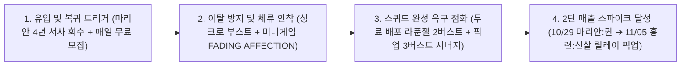
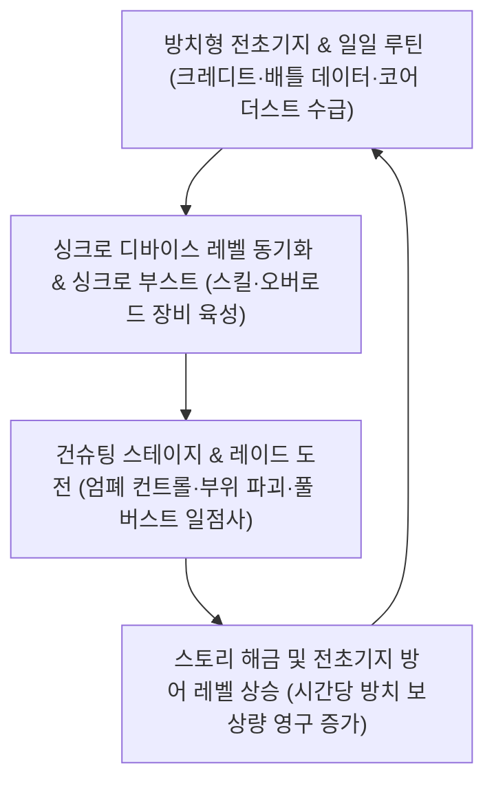

# [심층 분석 및 실플레이 보고서] 『승리의 여신: 니케』 4주년 차트 역주행 요인 및 개발·기획 관점 메커닉스 분석

> **문서 메타데이터**
> - **작성자**: 조준수 (게임 기획 / 클라이언트 개발 준비생)
> - **작성일**: 2026-11-05
> - **타깃 게임**: 『승리의 여신: 니케 (GODDESS OF VICTORY: NIKKE)』
> - **개발사 / 배급사**: 시프트업 (SHIFT UP Corp.) / 레벨 인피니트 (Level Infinite, Proxima Beta Pte. Ltd.)
> - **과제 분류**: 전공 포트폴리오 수업 과제 (ASSIGNMENT 06) — 마켓 역주행 원인 규명 / 코어 메커닉스 분석 / 실플레이 UX·QA 및 역기획 보고서

---

## 목차
1. [핵심 결론 (Executive Summary): 왜 서비스 4년 차에 다시 1위에 올랐는가?](#1-핵심-결론-executive-summary-왜-서비스-4년-차에-다시-1위에-올랐는가)
2. [게임 개요 및 시계열 마켓 지표 (Fact-Sheet)](#2-게임-개요-및-시계열-마켓-지표-fact-sheet)
3. [최신 4주년 업데이트(MARIA-n) 해부: 역주행을 만든 라이브 옵스 설계](#3-최신-4주년-업데이트maria-n-해부-역주행을-만든-라이브-옵스-설계)
4. [기본 메커닉스 및 핵심 재미 요소(Core Fun) 분석](#4-기본-메커닉스-및-핵심-재미-요소core-fun-분석)
5. [직접 플레이 경험 및 UX 피드백 (Direct Play Experience)](#5-직접-플레이-경험-및-ux-피드백-direct-play-experience)
6. [직무별 심층 해석 1: 개발자 관점 (Client / Tech / QA)](#6-직무별-심층-해석-1-개발자-관점-client--tech--qa)
7. [직무별 심층 해석 2: 기획자 관점 (System / Level / BM)](#7-직무별-심층-해석-2-기획자-관점-system--level--bm)
8. [학생 개발자·기획자 관점의 개선 제안 및 종합 결론](#8-학생-개발자기획자-관점의-개선-제안-및-종합-결론)

---

## 1. 핵심 결론 (Executive Summary): 왜 서비스 4년 차에 다시 1위에 올랐는가?

2022년 11월 출시되어 서비스 만 4년을 맞이한 『승리의 여신: 니케』는 픽업 비수기였던 2026년 10월 29일 기준 국내 Google Play 매출 35위, App Store 35위권 밖까지 하락했으나, **4주년 대규모 업데이트(`MARIA-n`) 반영 직후 국내 Apple App Store 매출 1위, Google Play 매출 3위(▲32계단 급등)**, **일본 Google Play 매출 1위**, **대만 App Store 매출 1위**를 동시에 석권하며 폭발적인 차트 역주행을 기록했다.

단순히 "주년 기념 무료 뽑기를 많이 뿌려서" 순위가 오른 것이 아니다. 직접 플레이하고 업데이트 구조를 역추적한 결과, 이번 역주행의 본질은 **[4년 서사의 회수 ➔ 무료 배포를 통한 덱 시너지 앵커링 ➔ 육성 병목 완화]**로 이어지는 치밀한 **3단 라이브 옵스(LiveOps) 깔때기 설계**에 있다.

### 순위 상승을 견인한 3대 핵심 결론
1. **프롤로그 떡밥의 4년 만의 회수 (Narrative Payoff)**:
   게임을 한 번이라도 해본 유저라면 누구나 기억하는 챕터 1의 비극적 히로인 **'마리안'**을 전면에 내세워, 메인 스토리 1부 최종 결전(49·50챕터 제3차 지상 탈환전)과 풀보이스 이벤트 스토리 **`MARIA-n`**을 동시에 개방했다. 이는 휴면 유저들에게 *"결말은 내 눈으로 직접 봐야 한다"*는 강력한 **서사적 복귀 동기**를 부여했다.
2. **무료 배포 캐릭터를 '과금 촉매제'로 전환한 덱 시너지 설계 (Deck-Completion Anchoring)**:
   4주년 신규 필그림 3종을 모두 **'작열 코드'**로 통일하면서, **2버스트 지원형인 `라푼젤 : 생츄어리`를 이벤트 무료 배포**로 풀었다. 라푼젤은 풀 버스트 진입 시 '임전' 상태 아군의 화력을 극대화하는 구조를 지녀, 유저 입장에서는 *"핵심 파츠인 2버스트 힐러/버퍼를 공짜로 받았으니, 픽업 중인 3버스트 주력 딜러(`마리안 : 퀸`, `홍련 : 신살`)만 뽑으면 1티어 작열 종결 스쿼드가 완성된다"*는 합리적 과금 명분이 형성되었다.
3. **고질적 성장 병목을 타격한 `싱크로 부스트`와 루도내러티브 미니게임 바이럴**:
   복귀 유저의 최대 이탈 원인이었던 스킬칩·오버로드 장비 파밍 격차를 신규 성장 지원 시스템 **`싱크로 부스트`**(시뮬레이션 룸 오버클럭 및 요격전 혜택 강화)로 완화하고, 서사형 텍스트 어드벤처/로그라이크 미니게임 **`FADING AFFECTION`**이 커뮤니티에서 자발적 입소문을 타며 리텐션과 결제를 동시에 끌어올렸다.

---

## 2. 게임 개요 및 시계열 마켓 지표 (Fact-Sheet)

### 2.1 기본 정보
- **정식 명칭**: 승리의 여신: 니케 (GODDESS OF VICTORY: NIKKE)
- **지원 플랫폼**: Android / iOS / Windows PC 공식 클라이언트 (크로스 플레이 지원)
- **최초 출시일**: 2022-11-04 (2026년 11월 기준 서비스 4주년)
- **대표 장르**: 서브컬처 수집형 건슈팅(TPS 아케이드 엄폐 사격) + 방치형 성장 RPG
- **클라이언트 기술 기반**: Unity 엔진 + Spine 2D 본(Bone) 애니메이션 및 커스텀 물리 시뮬레이션
- **비즈니스 모델(BM)**: 확률형 캐릭터 모집(특수/일반/필그림 선택), 골드 마일리지(이월 천장), 코스튬 가챠 및 미션 패스, 성장 패키지

### 2.2 시계열 매출 순위 추이 (Ground Truth 교차 검증)
*출처: 모바일인덱스(MobileIndex) 국내 실시간/일간 매출 기준 및 4주년 글로벌 마켓 집계 교차 대조*

| 기준 시점 | 국내 Google Play 매출 | 국내 App Store 매출 | 글로벌 주요 성과 및 시장 상황 |
|:---:|:---:|:---:|:---|
| **2026-09-03** | 16위 | 20위권 | 하반기 통상 시즌 운영기 |
| **2026-09-17** | 34위 (▼18) | 30위권 밖 | 주년 직전 재화 비축기 진입으로 일시 하락 |
| **2026-10-01** | 15위 (▲19) | 20위권 | 신규 픽업 반등 후 재차 관망세 전환 |
| **2026-10-29** | **35위 (▼20)** | **35위권 밖** | 4주년 업데이트 패치 당일 반영 전 최저점 (폭풍전야) |
| **2026-11월 초 (4주년)** | **3위 (▲32)** | **1위 (최정상 탈환)** | **일본 구글 1위 / 대만 iOS 1위 등 글로벌 동시 역주행 달성** |

> **[시계열 데이터 해석]**: 『승리의 여신: 니케』는 평시 15~35위권에서 에너지를 응축했다가 반주년·주년 필그림 픽업 시점에 양대 마켓 최상위권으로 수직 분출하는 전형적인 **'이벤트 드리븐 버스트(Event-Driven Burst) BM'** 곡선을 그린다. 특히 iOS는 업데이트 직후 즉각 1위로 직행했고, 매출 이동평균이 반영되는 Google Play 역시 35위에서 3위까지 32계단을 단숨에 뛰어오르며 하드코어 MMORPG 상위권(`도깨비의세계`, `제우스`)의 턱밑까지 추격했다.

---

## 3. 최신 4주년 업데이트(`MARIA-n`) 해부: 역주행을 만든 라이브 옵스 설계

| 업데이트 항목 | 핵심 세부 내용 | 기획 및 매출 기여 역할 |
|:---|:---|:---|
| **신규 필그림 3종** (작열 코드 시너지) | • **마리안 : 퀸** (10/29~11/19 픽업 \| 화력형·MG·3버스트 광역 딜러) • **홍련 : 신살** (11/05~11/26 픽업 \| 화력형·AR·3버스트 관통 딜러) • **라푼젤 : 생츄어리** (이벤트 무료 배포 \| 지원형·RL·2버스트 힐·임전 버퍼) | **매출 2단 점화 & 덱 빌딩 유도**: 1주차(마리안)와 2주차(홍련, 11/05 오픈)로 핵심 딜러 픽업을 시차 배치하여 월말·월초 매출 고점을 두 번 형성함 |
| **메인 49·50챕터 &** **이벤트 `MARIA-n`** | • 메인 스토리 1부 대단원 '제3차 지상 탈환전' 개방 • 마리안의 기원과 지휘관의 과거를 다룬 풀보이스 대형 스토리 이벤트 | **휴면 복귀 & IP 팬덤 결집**: 서사 완결성을 무기로 이탈 유저의 복귀 장벽을 감정적으로 돌파 |
| **서사형 미니게임** **`FADING AFFECTION`** | • 연구소 기록 열람 기반의 선택형 텍스트 어드벤처 + 로그라이크 루프 • 다회차 분기 선택과 마리아 모델의 소모·마모 과정을 시스템화 | **체류 시간(Time Spent) & 바이럴**: 단순 미니게임을 넘어 본편 서사의 여운을 극대화하며 커뮤니티 해석 글 양산 |
| **신규 성장 지원** **`싱크로 부스트`** | • 싱크로 디바이스 증폭 구간 이후 활성화되는 상시 파밍 가속 시스템 • **오버클럭 부스트**(스킬칩 보상 증가) + **요격전 부스트**(장비/모듈 수급 가속) | **육성 병목 해소 & 리텐션 방어**: 신규 필그림을 뽑고도 스킬칩·모듈이 없어 못 키우던 고질적 불만을 직접 해결 |
| **유저 친화 혜택 &** **`디오라마 로비`** | • 신규 특수 모집 및 필그림 선택 모집 **매일 1회 무료 모집** 제공 • SD 캐릭터 입체 배치가 가능한 **디오라마 로비** 추가 및 슬롯 15개 확장 | **일일 접속 강제(DAU 유지) & 애정 강화**: 매일 무료 뽑기로 접속 루틴을 고정하고, 수집 캐릭터의 관상 가치를 제고 |

---

## 4. 기본 메커닉스 및 핵심 재미 요소(Core Fun) 분석

### 4.1 코어 게임플레이 루프 (Core Gameplay Loop)

### 4.2 전투 메커니즘의 4대 재미 축 (Mechanics Breakdown)

1. **엄폐(Cover) ↔ 사격(Fire)의 상태 전환과 리소스 관리**:
   과거 오락실 건슈팅 명작 *타임 크라이시스(Time Crisis)*의 문법을 모바일 터치·드래그 및 PC 마우스 조작으로 이식했다. 각 캐릭터 앞의 엄폐물은 별도의 체력(Cover HP)을 가진다. 보스의 광역기 예고 모션(붉은 안광 및 타겟팅 라인)을 읽고 **전체 엄폐(스페이스바 / 캐릭터 탭)**로 즉사기를 막아내는 순간, 수집형 RPG가 곧바로 **피지컬 액션 게임**으로 변모한다.
2. **버스트 체인(`Ⅰ ➔ Ⅱ ➔ Ⅲ ➔ Full Burst`)과 일점사 쾌감**:
   스쿼드 5인을 구성할 때 `버스트 Ⅰ(20초)` ➔ `버스트 Ⅱ(20초)` ➔ `버스트 Ⅲ(40초 딜러 2인 교대)`의 쿨타임 아귀를 맞추는 **덱 빌딩 퍼즐**이 작동한다. 3단계 연계가 완성되면 10초간 **'풀 버스트(Full Burst)'** 타임에 돌입하며, **나머지 4명의 AI 니케들이 플레이어가 조준하는 크로스헤어 한 점으로 모든 탄환을 집중 사격**한다.
3. **6종 화기 아키타입에 따른 손맛의 분화**:
   - **RL(로켓 런처) / SR(스나이퍼 라이플)**: 풀 차지 배율 사격은 물론, 빠른 비차지 연사(유저 속칭 '톡톡이')를 통해 수동 조작 시 버스트 게이지를 폭발적으로 앞당기는 **고수용 테크닉(Skill Ceiling)**을 제공한다.
   - **MG(머신건, 예: `마리안 : 퀸`)**: 사격 지속 시 연사 속도가 최대치로 예열(Ramp-up)되며 압도적인 탄막으로 다수의 잡몹과 발사체를 지워버리는 쾌감을 준다.
   - **AR(소총, 예: `홍련 : 신살`) / SG(샷건) / SMG(기관단총)**: 관통(Pierce) 특화 시 보스의 파츠와 본체 코어를 동시에 꿰뚫어 판정 횟수를 배가시키거나, 근접 대형 코어를 분쇄하는 역할군별 손맛이 뚜렷하다.
4. **보스 기믹 파훼: 부위 파괴(Parts Break)와 저지 원(QTE)**:
   보스 패턴 도중 생성되는 붉은색 **'저지 원(Interruption Circle)'**을 제한 시간 내에 정확한 순서와 화력으로 파괴하지 못하면 전멸기가 발동한다. 이 장치 덕분에 권장 전투력보다 15~25% 낮은 **전투력 적자(CP Deficit) 상태에서도 수동 에임 트래킹과 버스트 타이밍 조절로 상위 스테이지를 클리어('투력 비비기')**할 수 있다.

---

## 5. 직접 플레이 경험 및 UX 피드백 (Direct Play Experience)

### 5.1 플레이 검증 환경 및 진행 내역
- **플레이 기간**: 2026-11-01 ~ 2026-11-05 (5일간 집중 검증, 금일 `홍련 : 신살` 픽업 오픈 시점까지 확인)
- **누적 플레이 타임**: 약 11시간 30분 (PC 클라이언트 8시간 30분 / 모바일 3시간 교차 플레이)
- **검증 디바이스**: Windows 11 데스크톱 PC 공식 클라이언트 (FHD 16:9 전체화면/창모드) & Android 스마트폰 (세로 9:16, 60fps 설정)
- **체험 범위**: 초반 메인 챕터 온보딩 재검증(챕터 1~8 구간) + 4주년 이벤트 스토리 `MARIA-n` 전 스테이지 + 미니게임 `FADING AFFECTION` 다회차 루트 열람 + 특수 모집(`마리안 : 퀸`, `홍련 : 신살`) 및 무료 배포(`라푼젤 : 생츄어리`) 실전 편성 테스트

### 5.2 구간별 실플레이 체감 및 UX 피드백 (Positive vs Pain Points)

#### [긍정 UX] 몰입과 손맛을 만든 경험
1. **프롤로그 조작과 4주년 메인 테마의 완벽한 서사적 호응**: 초반 챕터 1 마지막에서 침식된 마리안을 향해 플레이어가 **직접 손가락/마우스로 조준점을 옮겨 방아쇠를 당기게 만드는 인터랙티브 연출**이 4주년 모집 배너의 `마리안 : 퀸` 및 이벤트 스토리 `MARIA-n`과 직결되며 압도적 몰입감을 형성했다.
2. **PC 클라이언트의 가로(Wide) 시야각이 주는 슈팅 쾌적성**: 모바일 세로(9:16)의 좌우 패닝 제약과 달리, PC 클라이언트(16:9)에서는 **5인 스쿼드 전원의 사격/재장전 모션과 보스의 좌우 부위가 한 화면에 전부 들어와** 정밀 코어 에이밍의 재미가 배가되었다.
3. **미니게임 `FADING AFFECTION`의 감정선 설계**: 연구소의 파편화된 기록을 열람하며 선택지를 반복하는 동안, 마리아 모델 개체들이 소모·마모되는 과정을 **플레이어 스스로 다회차 반복 플레이를 통해 똑같이 체감하게 만든 루도내러티브 연출**이 깊은 인상을 남겼다.

#### [불편 UX] 개선이 시급한 페인 포인트
1. **로비 진입 직후의 심각한 인지 과부하 (UI Clutter & Pop-up Fatigue)**: 복귀/신규 진입 시 수십 개의 **붉은 알림 점(Red Dot)**이 동시 점등되며, 스테이지 클리어 직후 돌발 노출되는 **시간 제한 과금 팝업(Flash Offer)**이 시리어스 스토리의 여운을 해쳤다.
2. **메뉴 간 이동 시 잦은 암전 로딩과 네트워크 대기 (Transition Latency)**: `메인 로비 ➔ 방주 ➔ 전초기지 ➔ 이벤트 필드` 이동 시마다 씬 로딩이 발생해, 비전투 동선 소요 시간이 실제 전투 시간(1분 30초 내외)보다 길어지는 피로감이 체감되었다.
3. **복잡한 스킬 텍스트 가독성과 직관성 부족**: 고유 버프 명칭('임전' 상태 등), 중첩 조건, 비례 수식이 작은 줄글로 밀집되어 있어 직관적 키워드 툴팁과 HUD 가시성 개선이 요구된다.

---

## 6. 직무별 심층 해석 1: 개발자 관점 (Client / Tech / QA)

### 6.1 Spine 2D 채택과 커스텀 스프링 물리(Spring Physics) 최적화
- **왜 Live2D가 아닌 Spine 2D인가?**: 정면 메쉬 변형 중심의 Live2D와 달리, 엄폐 자세 전환과 마우스/터치 좌표 방향의 실시간 총구 회전(Aim Tracking / IK)을 정밀 제어하기 위해 계층적 본(Bone) 기반의 **Spine 2D** 상태머신(`Cover_Idle` ↔ `Aim_Fire` ↔ `Reload` ↔ `Stun`)을 구축했다.
- **훅의 법칙 기반 동적 본(Dynamic Bone)과 멀티스레딩 처리**: 키프레임 본과 물리 전용 본을 분리한 뒤 감쇠 스프링 물리($F = -kx - cv$)와 보조 구속 조건을 적용했고, 5명의 Spine 캐릭터와 수십 기의 랩쳐·탄막이 동시에 연산되는 풀 버스트 구간의 CPU 병목을 **Unity C# Job System과 Burst Compiler** 병렬 연산으로 최적화했다.

### 6.2 가변 종횡비(9:16 ↔ 16:9) 대응과 다중 히트박스 판정 로직
- 레터박스 없이 실제 전장 카메라의 수평 시야각(FOV)을 동적으로 확장하고 Safe Area 앵커링으로 UI를 재배치했다.
- `홍련 : 신살`과 같은 관통(Pierce) 딜러 사격 시 보스 파츠 콜라이더와 본체 코어 콜라이더가 중첩된 선상에서 다중 히트 판정이 프레임 드랍 없이 정확히 산출되도록 설계되어 있다.

### 6.3 클라이언트 QA 결함 및 기술적 리스크 리포트

| 이슈 ID | 결함 / 리스크 명칭 | 심각도 | 발생 조건 및 재현 스텝 | 개발자 관점 원인 진단 및 해결 방향 |
|:---:|:---|:---:|:---|:---|
| **TECH-01** | **PC 런처 외부 CDN 스크립트 변조 보안 이슈** | **Critical** | 4주년 전후 PC 전용 런처 구동 시 외부 CDN 웹뷰 스크립트 공급망 취약점 노출 사례 | 임베디드 웹뷰가 외부 CDN JS 로드 시 **SRI(Subresource Integrity) 해시 검증** 및 디지털 서명 핀닝 강제 필요 |
| **TECH-02** | **프레임레이트(FPS) 종속 연사 화기 발사 틱 손실** | **Major** | 30fps 설정 또는 모바일 발열 스로틀링 상태에서 고속 연사 MG(`마리안 : 퀸` 등) 사격 시 60fps 대비 누적 탄수 하락 | `Update()` 루프에서 잔여 `deltaTime` 미이월 시 발생하는 **Frame-rate Dependent DPS 손실**. 누적 시간 보정 루프 필수 |
| **TECH-03** | **콘텐츠 씬 전환 시 Addressables 메모리 스파이크** | **Major** | 디오라마 로비 ↔ 이벤트 3D SD 필드 ↔ 방주 반복 이동 시 2~4초 암전 로딩 지연 | 고해상도 Spine 아틀라스·풀보이스 에셋의 빈번한 언로드/로드로 인한 GC 스파이크. 공용 에셋 상주 풀링 및 비동기 프리페칭 권장 |
| **TECH-04** | **미니게임 `FADING AFFECTION` 분기 달성 표기 혼선** | **Minor** | 다회차 선택지 열람 중 특정 루트 완료 후에도 100% 달성 조건 인지가 모호하거나 배지 잔류 | 다회차 플래그 상태 트리와 UI 진행도 매핑 시 미열람 서브 노드 시각화 가이드 보완 필요 |

---

## 7. 직무별 심층 해석 2: 기획자 관점 (System / Level / BM)

### 7.1 전투력 패널티(CP Deficit) 레벨 디자인의 양면성
- 기준 전투력 미달 비율(%)에 따라 최종 스탯에 비선형 패널티를 부과하여 무제한 콘텐츠 소모를 막는 **타임 게이트(Time-Gate)** 역할을 수행한다.
- 동시에 15~25% 적자 구간에서는 자동 전투는 전멸하지만 수동 엄폐·부위 파괴·버스트 타이밍 제어로 클리어가 가능하도록 설계해 **컨트롤 효능감**과 **성장 동기**를 양립시켰다.

### 7.2 싱크로 디바이스와 4주년 `싱크로 부스트`의 경제학
- **싱크로 디바이스**: 상위 5인 레벨만 올리면 명함 신규 캐릭터도 획득 즉시 최고 레벨로 실전 투입 가능하여 가챠 전환율을 극대화한다.
- **싱크로 부스트**: 4년 서비스 누적으로 심화된 스킬칩(오버클럭) 및 커스텀 모듈(특수 요격전) 2차 육성 병목을 정조준해 해소함으로써 신규 필그림 뽑기 유인을 회복시켰다.

### 7.3 가챠 확률(1%) 저항을 돌파한 '골드 마일리지 영구 이월' BM 역기획
- 필그림 픽업 1% 확률의 저항을 **기간 만료 없는 200뽑기 골드 마일리지 정가 교환**으로 상쇄해 무·소과금 이탈을 방어하고, **2종 릴레이 픽업(`마리안 : 퀸` ➔ `홍련 : 신살`)** 및 **3돌파 로비 연출·코스튬 가챠**로 고과금 매출을 분리 회수하는 **가격 차별화(Price Discrimination)** 구조를 완성했다.

---

## 8. 학생 개발자·기획자 관점의 개선 제안 및 종합 결론

1. **[클라이언트/보안]** 런처 웹뷰 리소스 SHA-384 **SRI 해시 검증 의무화** 및 일일 숙제(자문·파견·전초기지 수령) **단일 비동기 오버레이 대시보드화**.
2. **[UI/UX]** 시리어스 스토리 감상 직후 기간 한정 패키지 팝업 호출을 유예하는 **세션 쿨다운(Session Throttling)** 규칙 도입.
3. **[시스템/레벨 기획]** 메인 스토리 1부(1~50챕터) 완결 기념 고정 대여 스쿼드 기반 **아카이브 시네마틱 진행 모드 상설 확대**.
4. **[전투 UX]** 스킬 창 내 고유 버프 키워드('임전' 등) 탭/호버 시 연관 시너지 니케와 발동 조건을 보여주는 **중첩 툴팁(Nested Tooltip) UI** 도입.
