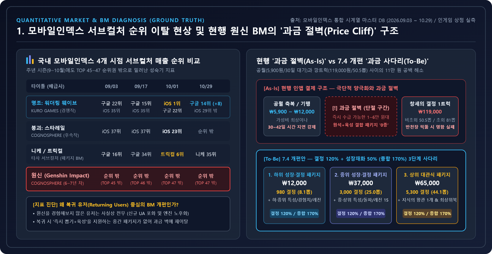
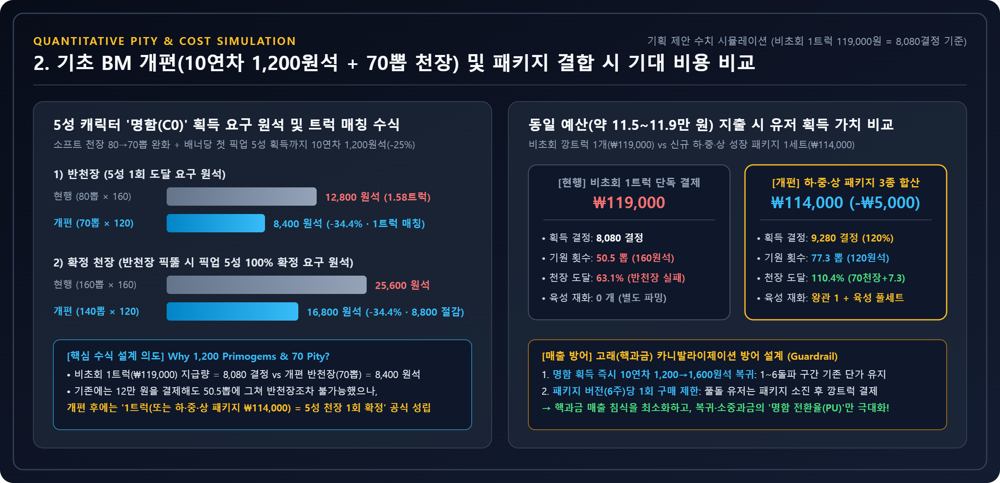
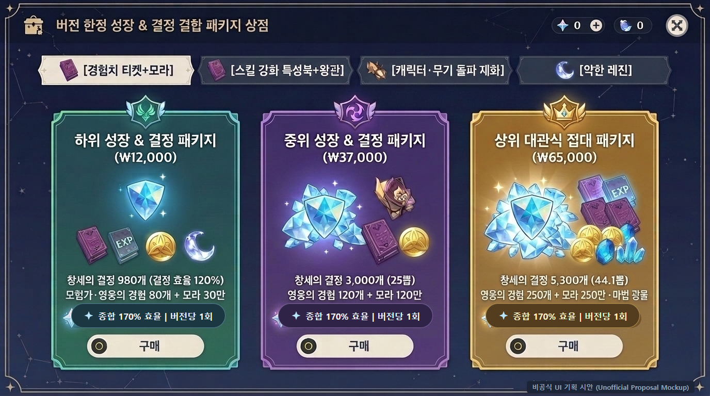
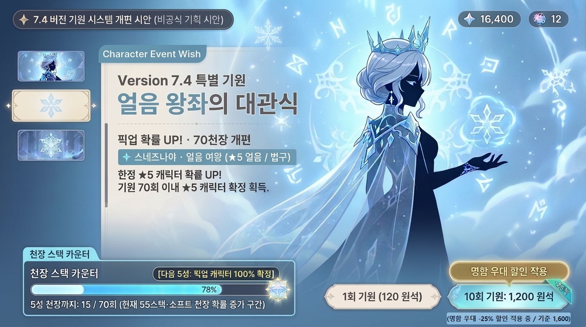

# [과제 08] 『원신』 7.4 버전 인앱 결제 및 기원 BM 개편 기획서

> **문서 메타데이터**
> - **작성자**: 조준수 (Jo Junsu)
> - **작성일**: 2026-11-19
> - **과제 분류**: 전공 포트폴리오 수업 과제 08 — 라이브 서비스 성숙기 BM 역기획 및 인앱 결제 개편 제안
> - **타깃 게임**: 『원신 (Genshin Impact)』 (`miHoYo Co., Ltd.` / `COGNOSPHERE PTE. LTD.`)
> - **문서 성격**: 공개 마켓 지표(Ground Truth) 및 작성자 실플레이 검증에 기반한 **비공식 기획 제안서(Proposal)**. 본문 내 7.4 버전 개편 수치·패키지 단가·시뮬레이션은 파일럿(테스트) BM 제안값이며 실제 운영 공지가 아님.

---

## 0. 핵심 요약 및 기획 의도

서비스 6~7년 차(7.4 버전 얼음 여왕 출시 및 차기 '별바다' 확장 국면)에 진입한 『원신』은 보수적인 '트럭+공월+기행' BM으로 누적 수조 원의 매출을 기록했으나, 신규 유입 모수 포화와 엔진 노후화 속에서 **휴면·복귀 유저(`별의 귀환`)와 소·중과금 유저의 재정착**을 가로막는 구조적 한계를 드러내고 있다.

본 기획서는 가챠 확률(0.6%)이나 고래(6돌파) 수익 모델을 무리하게 훼손하지 않으면서 **복귀·소중과금 유저의 명함(C0) 획득 허들과 육성 병목을 해소**하기 위한 3대 개편안을 제안한다.

1. **기초 기원 단가 및 천장 개편**: 소프트 천장 상시 완화(`80뽑 → 70뽑`, 하드 80회) + 배너당 첫 픽업 5성(명함) 획득까지 **10연차 `1,600 → 1,200 원석`(-25%) 할인** (`70뽑 × 120원석 = 8,400원석`으로 비초회 1트럭 `8,080결정`과 1:1 매칭).
2. **인게임 상호작용 성장 패키지 (120% / 170% 효율)**: 3:1 합성 체계 기반 4대 재화(`경험치·모라` / `특성북·왕관` / `돌파재화` / `약한 레진`) × 3단계 가격(`₩12,000` / `₩37,000` / `₩65,000`) 신설. **순수 결정 효율 120% + 인게임 재화 50% = 종합 170% 효율**을 적용하고 버전(6주)당 카테고리·등급별 1회 구매 제한으로 파일럿 운영.
3. **기원 천장 직관화 기본 UI**: 다크패턴 결제 유도 팝업을 배제하고, 기원 메인 화면 내 **`[5성 천장까지 N / 70회]`**, **`[반천장/확정천장 상태]`**, **`[명함 -25% 할인 적용 중]`** 실시간 게이지를 상시 제공.

---

## 1. 기획 배경 및 시장 지표 분석 (Ground Truth)

### 1.1 작성자 실플레이 검증 환경
- **『원신』 실플레이 지표**: 모험 등급(AR) 59 / 월드 레벨 9 / 나타(Natlan) 이하 주요 지역 수집도 최소 85% ~ 최대 100% 달성 ([게임 플레이 이력](../../200_Areas/게임%20플레이%20이력.md))
- **비교 서브컬처 BM 경험군**: 『림버스 컴퍼니』(Lv.100 / 시즌패스 Lv.623), 『블루 아카이브』(Lv.90), 『페르소나 5 더 팬텀 X』(Lv.80), 『트릭컬 리바이브』(Lv.114), 『소녀전선 2: 망명』(Lv.60)

### 1.2 모바일인덱스 4개 시점 시계열 순위 검증
[모바일인덱스 통합 시계열 마스터 DB](../../300_Resources/모바일인덱스_데이터베이스/모바일인덱스_통합_시계열_순위_마스터_DB.md)의 4개 스냅샷(`2026-09-03`, `2026-09-17`, `2026-10-01`, `2026-10-29`)을 교차 대조한 결과, 주년 시즌이 포함된 9~10월 전 구간에서 『원신』은 양대 마켓 TOP 45~47 순위권 밖(`OUT`)에 머물렀으며, 오픈월드 경쟁작 『명조: 워더링 웨이브』는 iOS 1위(10/01)·구글 14위(10/29)를 기록했다.

| 게임명 | 공식 배급사 | 2026-09-03 (구글/iOS) | 2026-09-17 (구글/iOS) | 2026-10-01 (구글/iOS) | 2026-10-29 (구글/iOS) | 해석 |
|:---|:---|:---:|:---:|:---:|:---:|:---|
| **명조: 워더링 웨이브** | KURO GAMES | 22위 / 35위 | 15위 / 35위 | 22위 / **1위** | **14위** / 29위 밖 | 오픈월드 경쟁작 픽업 버스트 강세 |
| **붕괴: 스타레일** | COGNOSPHERE | 45위 밖 / 37위 | 46위 밖 / 37위 | 47위 밖 / **23위** | 47위 밖 / 47위 밖 | 자사 후속작 업데이트 시 iOS 중상위권 진입 |
| **젠레스 존 제로** | COGNOSPHERE | 45위 밖 / 45위 밖 | 46위 밖 / 46위 밖 | 47위 밖 / **39위** | 47위 밖 / 47위 밖 | 자사 신작 픽업 시 iOS TOP 40 재진입 |
| **원신 (Genshin Impact)** | COGNOSPHERE | **순위권 밖** | **순위권 밖** | **순위권 밖** | **순위권 밖** | 9~10월 4개 스냅샷 전 구간 TOP 45~47 밖 |

---

## 2. 현행 BM 역기획 및 문제점 (As-Is)

| 상품 구분 | 결제 금액 | 지급 재화 (환산) | 획득 기원 (160원석) | 1뽑당 단가 | 수급 방식 | 복귀·소중과금 유저 병목 |
|:---|---:|---:|---:|---:|:---:|:---|
| **공월 축복** | ₩5,900 | 3,000 (300결정+2,700원석) | 18.75 뽑 | ₩315 | 30일 출석 | 복귀 당일 즉시 뽑기 불가 |
| **진주 기행** | ₩12,000 | 1,320 상당 + 육성재화 | 8.25 뽑 | ₩1,455 | 약 42일 | 시즌 말기 복귀 시 Lv.50 달성 불가 |
| **중간 패키지 구간** | **₩12,000~₩65,000** | **0 (전무)** | **0 뽑** | **-** | **-** | **즉시 수급 가능한 원석+육성 결합 상품 부재** |
| **1트럭 (초회 2배)** | ₩119,000 | 12,960 결정 | 81.0 뽑 | ₩1,469 | 즉시 | 연 1회 한정, 반천장 1회분으로 픽뚫 시 명함 실패 |
| **1트럭 (비초회)** | ₩119,000 | 8,080 결정 | 50.5 뽑 | ₩2,356 | 즉시 | 반천장(80뽑)의 63.1%에 불과해 극심한 과금 저항 |

---

## 3. 개편안 1 — 기초 기원 단가 및 소프트 천장 개편 (To-Be)

1. **소프트 천장 상시 단축**: `74~80회(하드 90회)` → **`60~70회(하드 80회)`** 영구 완화.
2. **명함 구간 10연차 1,200 원석(-25%) 우대 할인**: 7.4 버전 이후 배너당 첫 픽업 5성(명함) 획득 시까지 `160 → 120 원석`(10연차 `1,200 원석` / 인연 8개 소모). 픽업 5성 명함 획득 이후 1~6돌파 구간은 `1,600 원석`으로 복귀.
3. **핵심 수식 정합성**: `70회 × 120원석 = 8,400원석`으로 비초회 1트럭(`8,080결정`) 결제 시 5성 천장 1회가 사실상 확정 보장된다.

---

## 4. 개편안 2 — 인게임 상호작용 성장 패키지 (120% / 170% 효율)

| 등급 구분 | 판매 금액 | 비초회 트럭 결정량 | 지급 결정 (순수 120%) | 명함 할인 환산 | 인게임 재화 가치 (+50%) | 종합 효율 | 구매 제한 |
|:---|---:|---:|---:|---:|---:|:---:|:---:|
| **하위 성장·결정** | ₩12,000 | 750 결정 | **980 결정** | 8.1 뽑 | 하·중위 재화 / 약한 레진 5개 | **170%** | 버전(6주)당 카테고리별 1회 |
| **중위 성장·결정** | ₩37,000 | 2,240 결정 | **3,000 결정** | 25.0 뽑 | 중·상위 재화 / 약한 레진 15개 | **170%** | 버전(6주)당 카테고리별 1회 |
| **상위 대관식** | ₩65,000 | 3,880 결정 | **5,300 결정** | 44.1 뽑 | 지식의 왕관 1개·최상위 세트 | **170%** | 버전(6주)당 카테고리별 1회 |
| **3종 합산** | **₩114,000** | *(1트럭 ₩119,000)* | **9,280 결정** | **77.3 뽑 (70천장+7.3)** | **캐릭터 1명 육성 풀세트** | **170%** | - |

4대 카테고리: **A. [경험치 티켓 + 모라]** / **B. [스킬 강화 특성북 + 왕관]** / **C. [캐릭터·무기 돌파 재화]** / **D. [약한 레진]**.

---

## 5. 개편안 3 — 기원 천장 직관화 기본 UI 설계

- 돌발 결제 유도 팝업을 배제하고, 기원 메인 화면 좌측 하단에 **`[5성 천장까지 N / 70회]`** 및 **`[반천장 50% / 픽업 100% 확정]`** 실시간 게이지를 상시 표기.
- 우측 하단 기원 버튼에는 명함 미보유 상태에서 **`[명함 우대 할인 -25%: 10회 1,200원석]`** 인디케이터를 표시하고, 명함 획득 즉시 일반 단가(`1,600원석`)로 전환.

---

## 6. 기대 효과, 카니발라이제이션 방어 및 KPI

- **복귀·소과금**: 미결제 이탈(`₩0`)에서 부족한 스택에 맞춰 `₩12,000 ~ ₩49,000` 성장 패키지 결제 전환(PU 상승).
- **중과금**: 버전당 `₩114,000`(하·중·상 3종)으로 `70천장 확정(77.3뽑)` + `왕관·육성 풀세트` 확보로 리텐션 강화.
- **고래 유저(카니발라이제이션 방어)**: 명함(첫 1회) 획득 즉시 `1,600원석`으로 복귀하고 패키지는 버전당 1회 제한이 걸려 있어 1~6돌파 구간의 깡트럭 매출 침식을 최소화.
- **파일럿 KPI**: 복귀 유저(`별의 귀환`) 패키지 전환율 및 D30 잔존율, 40~69스택 명함 구간 완주율, 4대 카테고리별 구매 비중, 고래 vs 비고래 Net Revenue Lift 교차 검증.
